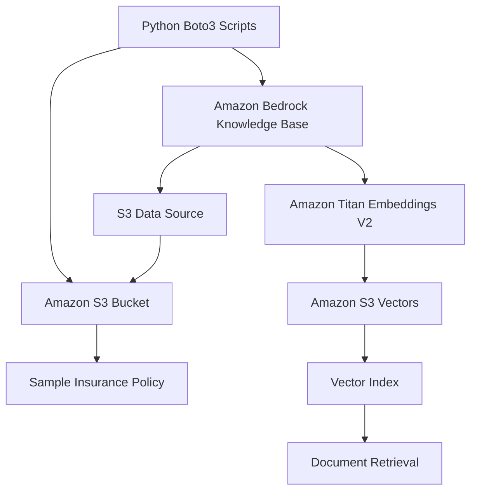

# 02 – Project Architecture

## 1. Architecture Overview

The solution uses Amazon Bedrock Knowledge Bases with Amazon S3 Vectors as the vector store.

Python Boto3 automates AWS resource creation and document ingestion.

## 2. Architecture Diagram

## 3. Component Responsibilities

| Component | Responsibility |
|---|---|
| Python Boto3 | Automates AWS resource creation |
| Amazon S3 | Stores source insurance documents |
| Bedrock Knowledge Base | Manages document ingestion and retrieval |
| S3 Data Source | Connects the source documents to the Knowledge Base |
| Titan Embeddings V2 | Converts document chunks into vector embeddings |
| Amazon S3 Vectors | Stores vector embeddings |
| Vector Index | Enables similarity search |

## 4. Data Flow

1. Python creates the required AWS resources.
2. The sample insurance document is uploaded to S3.
3. Bedrock Knowledge Base reads the document through its S3 data source.
4. The document is chunked.
5. Titan Embeddings V2 generates embeddings.
6. Embeddings are stored in the S3 Vector index.
7. The Knowledge Base can retrieve relevant document chunks.

## 5. Automation Approach

All infrastructure creation and ingestion operations will be performed using Python Boto3 instead of manually creating resources through the AWS Console.
# 02 – Project Architecture

## 1. Architecture Overview

The solution uses Amazon Bedrock Knowledge Bases with Amazon S3 Vectors as the vector store.

Python Boto3 automates AWS resource creation and document ingestion.

## 2. Architecture Diagram

## 3. Component Responsibilities

| Component | Responsibility |
|---|---|
| Python Boto3 | Automates AWS resource creation |
| Amazon S3 | Stores source insurance documents |
| Bedrock Knowledge Base | Manages document ingestion and retrieval |
| S3 Data Source | Connects the source documents to the Knowledge Base |
| Titan Embeddings V2 | Converts document chunks into vector embeddings |
| Amazon S3 Vectors | Stores vector embeddings |
| Vector Index | Enables similarity search |

## 4. Data Flow

1. Python creates the required AWS resources.
2. The sample insurance document is uploaded to S3.
3. Bedrock Knowledge Base reads the document through its S3 data source.
4. The document is chunked.
5. Titan Embeddings V2 generates embeddings.
6. Embeddings are stored in the S3 Vector index.
7. The Knowledge Base can retrieve relevant document chunks.

## 5. Automation Approach

All infrastructure creation and ingestion operations will be performed using Python Boto3 instead of manually creating resources through the AWS Console.